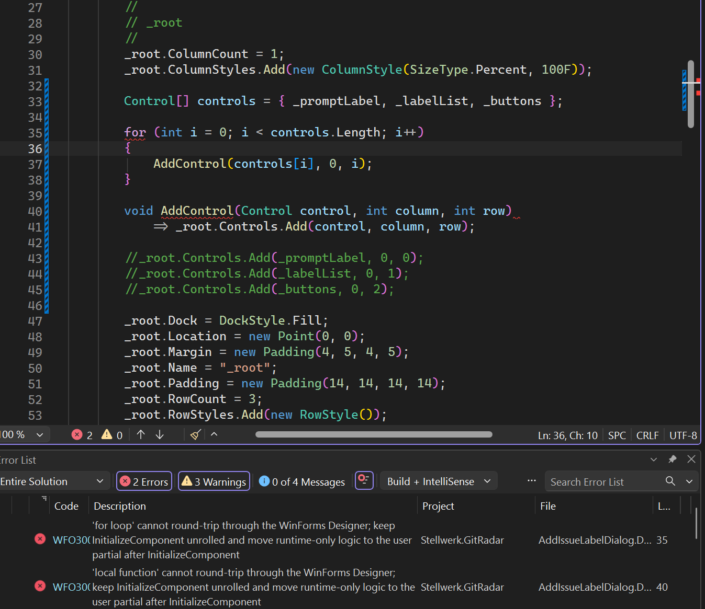

# How to use System.Windows.Forms.Analyzers

System.Windows.Forms.Analyzers analyzers and source generators are shipped inbox with Windows Desktop .NET SDK, and
are automatically referenced for Windows Forms .NET applications.

## Categories of analyzers

WinForms diagnostic IDs use the `WFO` prefix, followed by a four-digit number. The first digit identifies the series
the diagnostic belongs to:

### 0000 series: Application configuration

These diagnostics are reported by the `ApplicationConfigurationGenerator` source generator and the `AppManifestAnalyzer`.
They validate how a WinForms application is bootstrapped, for example the values passed through the MSBuild
application configuration properties (`WFO0001`, `WFO0002`) and high DPI settings in a custom `app.manifest`
(`WFO0003`). See [ApplicationConfigurationGenerator](ApplicationConfigurationGenerator.Help.md) and
[AppManifestAnalyzer](AppManifestAnalyzer.Help.md).

### 1000 series: WinForms security

These analyzers flag code patterns which could unintentionally persist or exchange data in an unsafe way, for example
`Control` properties which the Designer would silently serialize (`WFO1000`), or custom `IDataObject` implementations
which do not support the typed data APIs (`WFO1001`).

### 2000 series: WinForms usage

These analyzers flag API usage which compiles fine, but is likely to cause subtle bugs at runtime or at design time,
for example property getters returning fresh instances on every call (`WFO2000`) or passing `Task`-returning delegates
to `Control.InvokeAsync` without a cancellation token (`WFO2001`).

### 3000 series: WinForms Designer guardrails

These analyzers protect the generated partial declaration in `.Designer.cs` files and make sure its code can still be
loaded, edited, and saved by the WinForms Designer. They are described in detail
[in the analyzer reference below](#winforms-designer-guardrails).

**The rationale behind this:**

`.Designer.cs` files are usually generated exclusively by the WinForms Designer, and it has never been recommended
to modify them manually. With agents and AI writing code, this is no longer the case. Of course, we want agents and AI
to also _design_ the UI, and the only way they can do this is by writing the respective Designer code.

Now - here is the issue: Large Language Models (LLMs), and therefore the agents and harnesses which are guiding them,
have the intrinsic tendency to write efficient, compact, and "rolled-up" code with loops, helper methods, and lambdas.
That's often the exact opposite of what the code in `InitializeComponent` is supposed to look like.
You should always think of the code in `InitializeComponent` more like a JSON or an XML file: it is a _description_ of
the UI, which _happens_ to also execute and build said UI when it is called at runtime.
That is also the reason why this code is generated by the CodeDOM _serializer_. WinForms doesn't persist your UI
design with the XML serializer as XML, and not with the JSON serializer as JSON, but with the CodeDOM serializer
as - well - code!

That is also the reason why the WinForms Designer is so picky about what it can and cannot interpret. When the
Designer loads a form, it does not compile `InitializeComponent`; it parses the code into a CodeDOM tree and
_interprets_ it. CodeDOM is not a C# compiler either. It can only represent a subset of the C# language, and the
Designer, in turn, only interprets a subset of what CodeDOM can represent. Many of the constructs LLMs like to use
therefore cannot be loaded, and the Designer will fail to open the form - or, even worse, silently drop the code the
next time it saves the form.

For this reason, the 3000-series analyzers warn about code in Designer files which the Designer does not support and
which will therefore break the design-time experience. The current set of 3000-series analyzers is not exhaustive,
but in our experience it brings AI-generated Designer code to a level where the chance that the Designer can open it
is considerably higher than 90%.

To this end, we did one more thing, which might make the messages of these analyzers look a bit, well, odd at first
sight:



As you can see in the screenshot above, the analyzer messages are phrased so that they are directed primarily at
agents and LLMs: they state precisely what is wrong and how to fix it, for example by naming the unsupported construct
and telling where the runtime-only logic should go instead.

### 5000 series: Experimental APIs

These IDs are not reported by analyzers. They are attached to WinForms APIs which are marked as
`[Experimental]`, and you need to suppress the respective diagnostic to opt in to using those APIs. See
[Experimental](Experimental.Help.md).

# Analyzer reference

The following sections describe each analyzer of `System.Windows.Forms.Analyzers` and `System.Windows.Forms.Analyzers.CSharp`
which applies to C# projects, the diagnostics it reports, and how to resolve them. Every diagnostic ID links to its
documentation via `https://aka.ms/winforms-warnings/<id>`, which is also the help link shown in Visual Studio's Error List.

## `MissingPropertySerializationConfiguration`

`MissingPropertySerializationConfiguration` checks for missing `DesignerSerializationVisibilityAttribute` on properties of classes which are
derived from `Control` and could potentially serialize design-time data by the designer without the user being aware of it.

<a id="wfo1000"></a>

### [WFO1000](https://aka.ms/winforms-warnings/wfo1000): Missing property serialization configuration.

Properties of classes derived from `Control` should have `DesignerSerializationVisibilityAttribute` 
set to `DesignerSerializationVisibility.Content` or `DesignerSerializationVisibility.Visible`.

| Item      | Value            |
|-----------|------------------|
| Category  | WinForms Security|
| Enabled   | True             |
| Severity  | Error            |
| CodeFix   | False            |
| Added in  | NET9.0           |

---

## `AvoidPassingFuncReturningTaskWithoutCancellationToken`

`AvoidPassingFuncReturningTaskWithoutCancellationToken` checks parameters passed to `Control.InvokeAsync`. It suggests to use a cancellation token when passing a task to these methods.

<a id="wfo2001"></a>

### [WFO2001](https://aka.ms/winforms-warnings/wfo2001): Task is being passed to InvokeAsync without a cancellation token.

Avoid passing a `Func<T>` to `InvokeAsync` where `T` is a `Task` or `ValueTask`, unless your intention is for the delegate to simply be kicked off as an unsupervised task. Instead, use `Func<CancellationToken, ValueTask>` or `Func<CancellationToken, ValueTask<T>>`, so that the delegate passed to `InvokeAsync` can be awaited, allowing exceptions to be properly handled. 

| Item      | Value            |
|-----------|------------------|
| Category  | WinForms Usage   |
| Enabled   | True             |
| Severity  | Warning          |
| CodeFix   | False            |
| Added in  | NET9.0           |

---

## `ImplementITypedDataObject`

`ImplementITypedDataObject` checks custom implementations of the managed `IDataObject` interface and suggests to also implement the `ITypedDataObject` interface.

<a id="wfo1001"></a>

### [WFO1001](https://aka.ms/winforms-warnings/wfo1001): `IDataObject` type does not implement `ITypedDataObject`.

Types should implement `ITypedDataObject` to support best practices when interacting with data. Types will not work with typed APIs in Clipboard and other data exchange scenarios if they only implement `IDataObject`.

| Item      | Value            |
|-----------|------------------|
| Category  | WinForms Security|
| Enabled   | True             |
| Severity  | Warning          |
| CodeFix   | False            |
| Added in  | NET10.0          |

---

## WinForms Designer guardrails

These rules are reported by `InitializeComponentAnalyzer` (WFO3000, WFO3005–WFO3010) and
`DesignerFileStructureAnalyzer` (WFO3001–WFO3004). They protect the generated partial declaration in `.Designer.cs`
files. A file is analyzed only when its name ends with `.Designer.cs` and it contains an instance, non-generic,
parameterless `void InitializeComponent` for a partial class derived from `System.Windows.Forms.Control` or
`System.ComponentModel.Component`, and that same class also has a declaration in a non-Designer file. Framework
symbols are resolved semantically: unrelated types named `Control` or `Component` do not qualify. Although Roslyn
treats `.Designer.cs` files as generated code, these rules deliberately analyze and report diagnostics in them.

The boundary is design-time round-tripping, not runtime equivalence. CodeDOM cannot express many
modern language constructs, and the WinForms Designer interprets only a subset of the statements
CodeDOM can represent. Keep initialization unrolled: explicit construction, assignments, supported
calls, and named event hookups. Move runtime-only behavior to the user partial after
`InitializeComponent`; do not hide designer initialization in a helper call.

<a id="wfo3000"></a>

### [WFO3000](https://aka.ms/winforms-warnings/wfo3000): Avoid unsupported code in `InitializeComponent`.

Move loops (`for`, `foreach` - including deconstructing `foreach` -, `while`, `do`), `if` statements, `switch`
statements and `switch` expressions, local functions, `goto`, `try`, `lock`, `using` statements and declarations, and
`await` out of generated initialization. Use a block-bodied `InitializeComponent`, not an expression-bodied method.
These restrictions do not apply to the standard generated `Dispose` override.

```cs
// Reported: WFO3000 ('for loop')
Control[] controls = { _promptLabel, _labelList, _buttons };
for (int i = 0; i < controls.Length; i++)
{
    _root.Controls.Add(controls[i], 0, i);
}

// Designer-compatible: unrolled
_root.Controls.Add(_promptLabel, 0, 0);
_root.Controls.Add(_labelList, 0, 1);
_root.Controls.Add(_buttons, 0, 2);
```

<a id="wfo3001"></a>

### [WFO3001](https://aka.ms/winforms-warnings/wfo3001): Keep custom members out of Designer files.

Move properties, indexers, operators, nested types, and custom methods out of the generated partial declaration.
Fields, constructors, `InitializeComponent`, the standard `Dispose(bool)` override, and explicit interface
implementations are allowed.

<a id="wfo3002"></a>

### [WFO3002](https://aka.ms/winforms-warnings/wfo3002): Keep generated fields at the end of the Designer file.

Keep fields at the end of the Designer partial, except the conventional `IContainer components`
infrastructure. This ordering preserves the historical generated layout; it is not itself a CodeDOM
expression restriction. Component fields constructed in `InitializeComponent` must belong to that
partial, so the rule also reports such fields when they are declared in the user partial. Merely reading a user
field does not make it designer-owned, and inherited, static, or unrelated-type fields must not be moved into it.

<a id="wfo3003"></a>

### [WFO3003](https://aka.ms/winforms-warnings/wfo3003): Keep event and delegate declarations out of Designer files.

Move event and delegate declarations to the user code file.

<a id="wfo3004"></a>

### [WFO3004](https://aka.ms/winforms-warnings/wfo3004): Avoid collection expressions in Designer files.

Use syntax supported by Designer serialization instead of C# collection expressions anywhere in the generated
Designer partial, for example `new Control[] { button1, button2 }` or unrolled `Add` calls.

<a id="wfo3005"></a>

### [WFO3005](https://aka.ms/winforms-warnings/wfo3005): Avoid `nameof` expressions in `InitializeComponent`.

Use the serialized string value instead of `nameof`, for example `button1.Name = "button1";`. A method which
happens to be named `nameof` is not reported.

<a id="wfo3006"></a>

### [WFO3006](https://aka.ms/winforms-warnings/wfo3006): Avoid conditional expressions in `InitializeComponent`.

Move the `condition ? a : b` decision to the user code file and serialize one deterministic value.

<a id="wfo3007"></a>

### [WFO3007](https://aka.ms/winforms-warnings/wfo3007): Avoid null-coalescing expressions in `InitializeComponent`.

Resolve the fallback outside generated Designer code. This includes both `??` and `??=`.

<a id="wfo3008"></a>

### [WFO3008](https://aka.ms/winforms-warnings/wfo3008): Avoid null-conditional expressions in `InitializeComponent`.

Move null-dependent access (`?.` and `?[]`) to the user code file.

<a id="wfo3009"></a>

### [WFO3009](https://aka.ms/winforms-warnings/wfo3009): Avoid interpolated strings in `InitializeComponent`.

Serialize the resulting string value, or use a supported resource lookup, instead of an interpolated expression.

<a id="wfo3010"></a>

### [WFO3010](https://aka.ms/winforms-warnings/wfo3010): Avoid anonymous functions in `InitializeComponent`.

Use a named event handler in the user code file instead of a lambda or anonymous method, for example
`button1.Click += Button1_Click;`.

WFO3005–WFO3010 identify constructs that CodeDOM cannot represent. Their separate IDs allow tools and
agents to apply construct-specific guidance.

WFO3011 and WFO3012 are Visual Basic only; see the
[Visual Basic analyzer documentation](WinFormsVisualBasicAnalyzers.Help.md#wfo3011).

| Item      | Value             |
|-----------|-------------------|
| Category  | WinForms Designer |
| Enabled   | True              |
| Severity  | Error (WFO3000, WFO3001, WFO3003, WFO3004, WFO3006–WFO3008, WFO3010); Warning (WFO3002, WFO3005, WFO3009) |
| CodeFix   | False             |
| Added in  | NET11.0           |

---

## `PropertyAllocatesNewInstanceAnalyzer`

`PropertyAllocatesNewInstanceAnalyzer` checks property getters (C# and Visual Basic) for return paths which construct
a new reference-type instance on each call.

<a id="wfo2000"></a>

### [WFO2000](https://aka.ms/winforms-warnings/wfo2000): Avoid constructing fresh reference instances in property getters.

This is a general usage warning, not a Designer-only restriction. It identifies getter return paths
that directly construct a reference instance, without claiming that every access takes that path.
This includes directly returned arrays and anonymous objects. Each property is reported at most once.
Value-type construction, cached and initializer-backed properties (for example `_items ??= new()` or
`{ get; } = new()`), indexers, generated code (including `.Designer.cs` files), and returns inside nested
lambdas/local functions are excluded. User-defined conversions are not treated as transparent returns. The rule does
not perform interprocedural factory analysis.

```cs
// Reported (WFO2000): every access returns a different instance.
public List<string> Items => new();

// Not reported: stable identity.
public List<string> Items => _items ??= new();

// Not reported: value type.
public Padding Spacing => new(4);
```

Cache the instance only when stable identity is intended. For deliberate creation, consider a factory
method if API compatibility permits, or document a narrow suppression. There is no automatic fix:
caching can change ownership, disposal, and threading behavior. In particular, fresh instances from
content-serialized properties can discard property-grid edits instead of preserving designer state.

| Item      | Value          |
|-----------|----------------|
| Category  | WinForms Usage |
| Enabled   | True           |
| Severity  | Warning        |
| CodeFix   | False          |
| Added in  | NET11.0        |

---
